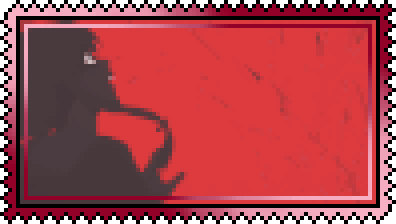

<p align="center">
  
</p>

<p align="center">
  <a href="https://lucha.navyri.online" title="Abrir Lucha o Muere en la nube">
    
  </a>
</p>

<p align="center">
  
  
  
  
  
</p>

El **frontend** de *Lucha o Muere* es la interfaz oscura y distópica desde la cual las tres facciones
administran el bloodsport: una aplicación **Next.js 15 (App Router + Turbopack)** con React 19,
Tailwind CSS v4 y componentes shadcn/ui. El middleware protege cada ruta por rol y redirige al panel
correspondiente; el cliente axios adjunta el token JWT en cada petición a la
[API backend](../backend/README.md). El tema usa paleta rojo sangre sobre negro, incluido un
scrollbar temático a juego.

<p align="center">
  
</p>

## Requisitos

| Componente | Versión | Notas |
|---|---|---|
| Node.js | 18+ | Next.js 15 con Turbopack |
| Backend | corriendo | [backend/](../backend/README.md) en local o desplegado en Render |

<p align="center">
  
</p>

## Arranque rápido

```bash
cd frontend
npm install
echo "NEXT_PUBLIC_API_URL=http://localhost:3000" > .env.local   # URL de la API, sin barra al final
npm run dev                     # http://localhost:3001
```

<p align="center">
  
</p>

## Variables de entorno

| Variable | Descripción |
|---|---|
| `NEXT_PUBLIC_API_URL` | URL base de la API (`http://localhost:3000` en local, `https://<servicio>.onrender.com` en Render) |

<p align="center">
  
</p>

## Paneles por rol

| Rol | Rutas | Qué puede hacer |
|---|---|---|
| Admin | `/admin/usuarios`, `/admin/crear-usuario`, `/admin/batallas` | Crear dictadores y sponsors, gestionar usuarios, aprobar/iniciar/cerrar batallas y ver eventos activos |
| Dictador | `/dictator/contestants`, `/dictator/batallas`, `/dictator/apuestas`, `/dictator/blackmarket`, `/dictator/inventario` | Gestionar concursantes, proponer combates, apostar, comprar en el mercado negro y aplicar buffs |
| Sponsor | `/sponsor/*` (las mismas secciones del dictador) | Financiar peleadores con ítems, publicar en el mercado negro, apostar y aplicar buffs |

El login (`/login`) entrega el JWT; el middleware de Next.js valida el token y el rol antes de
entrar a cada panel, y `/welcome` muestra la bienvenida con el selector.

<p align="center">
  
</p>

## Estructura

```text
frontend/
├── app/
│   ├── login/              # Inicio de sesión
│   ├── welcome/            # Bienvenida y selector de panel
│   ├── admin/              # usuarios · crear-usuario · batallas
│   ├── dictator/           # contestants · batallas · apuestas · blackmarket · inventario
│   ├── sponsor/            # lo mismo que dictator + publicaciones propias
│   ├── components/         # auth · layout · features (UI por rol)
│   └── globals.css         # Tema + scrollbar temático
├── middleware.ts           # Protección de rutas por rol
├── lib/api.ts              # Cliente axios con NEXT_PUBLIC_API_URL
└── .env.local              # No versionado (ver tabla de arriba)
```

<p align="center">
  
</p>

## Enlaces

- [Repo completo (backend + frontend)](../README.md)
- [Backend Express](../backend/README.md)
- [Guía de despliegue](../DESPLIEGUE.md)
- [Repositorio original del frontend](https://github.com/navyri/Frontend_Final_IngWeb)

<p align="center">
  
</p>

## Autora

· ©  <a href="https://github.com/navyri" target="_blank">**Mariana Esguerra**</a>

Proyecto final de Ingeniería Web — semestre 2025-1.

<p align="center">
  
</p>
